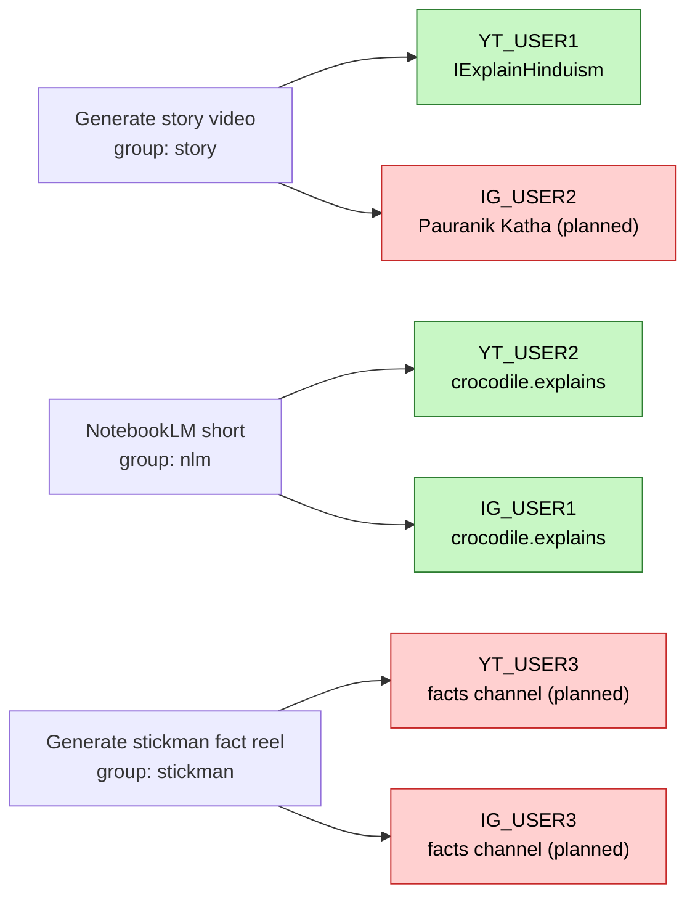

# AI YouTube Channel

GitHub Actions that make short videos by themselves. Finished files land on the `videos` branch. Nothing runs on your PC except two one-time token commands.

## What it makes

| Workflow | Output | How it runs | Needs |
|---|---|---|---|
| NotebookLM short | 60 s vertical explainer on a fresh topic an LLM picks from what was published before (science, technology, ai, space, physics), auto upload to YouTube and Instagram | Daily, due 9:07 am and 3:07 pm IST (tried every 30 min until published, 9:07 am to 8:07 pm), 2 a day, or by hand | NOTEBOOKLM_MASTER_TOKEN_JSON + at least one upload account for group `nlm` (LLM key optional: without one topics come from topics.json) |
| Upload video | Uploads an already made video from the `videos` branch to every account of a group (no NotebookLM quota) | By hand, or called by the three generation workflows | at least one complete IG_USERn_* or YT_* account |
| Generate story video | 2 min folk art story picked from what was published before (continues a saga or switches tradition), script, 16:9 and 9:16, captions, auto upload (shorts to YouTube + Instagram, landscape to YouTube) | Daily, due 11:17 am and 4:47 pm IST (tried every 30 min until published, 11:17 am to 7:47 pm), 2 a day, or by hand (own topic/script optional) | one LLM key, e.g. GEMINI_API_KEY + at least one upload account for group `story` |
| Generate stickman fact reel | 35 s vertical "did you know" fact with animated stick figures, hook question + answer + why, auto upload | Daily, due 1:27 pm and 5:57 pm IST (tried every 30 min until published, 1:27 pm to 7:57 pm), 2 a day, or by hand (own fact/script optional) | one LLM key, e.g. GEMINI_API_KEY + at least one upload account for group `stickman` |
| Pre-run check only | Probes LLM keys and the TTS voice, checks remaining Actions minutes when BILLING_TOKEN is set | By hand | one LLM key to pass |
| Report failure | Opens / updates one `pipeline-failure` issue when a daily run fails, closes it on the next success. Expected stops (no upload account, NotebookLM quota used up, not enough Actions minutes) are not failures: the run cancels itself (grey **Cancelled**) and the reason is in the run's summary | Called by the daily workflows | nothing |
| Cleanup old videos | Deletes videos older than 7 days | Weekly | nothing |

A scheduled slot only runs while fewer than 2 entries for today (UTC) exist in that workflow's index on the `videos` branch (`nlm.json`, `videos.json`, `stickman.json`); otherwise the guard job skips it. Manual runs ignore the guard, except runs started with the `auto` input on (that is how the dashboard's external trigger starts them, see below). A story rendered in both formats counts as one entry. Even when you give your own script, the story and stickman workflows still need an LLM key: the model writes the scene code.

**If GitHub's cron never fires** (it happens: scheduled runs are simply not created, nothing in the UI says why) the dashboard in `dashboard/` has an endpoint, `/api/trigger`, that Vercel's own scheduler calls every 15 minutes during the day (any other scheduler, such as cron-job.org, can call it too). It reads the same indexes, works out which of the three workflows is due right now (same due times as the cron) and starts it through the GitHub API with `auto=true`, so the guard job above still applies. Setup is in [dashboard/README.md](dashboard/README.md).

## Setup

### NotebookLM short (3 steps)

1. Get the NotebookLM token (throwaway Google account, run once on your PC):

   ```bash
   pip install "notebooklm-py[headless,browser]"
   notebooklm login --master-token --account throwaway@gmail.com
   ```

   Print the token file as **one line** and copy the output (a multi-line secret makes GitHub mask `{` and `}` and silently drop job outputs):

   ```bash
   python -c "import json,os;print(json.dumps(json.load(open(os.path.expanduser('~/.notebooklm/profiles/default/master_token.json')))))"
   ```

2. Repo > Settings > Secrets and variables > Actions > New repository secret > `NOTEBOOKLM_MASTER_TOKEN_JSON` > paste that single line.

3. Actions tab > NotebookLM short > Run workflow. Done. It now runs daily.

### Story video and stickman fact reel (1 step)

Create a free Gemini key at [aistudio.google.com/apikey](https://aistudio.google.com/apikey) and add it as secret `GEMINI_API_KEY` (any other provider from the table below works too). Then Actions > **Generate story video** or **Generate stickman fact reel** > Run workflow. No NotebookLM token needed.

### Uploads (optional)

Without upload accounts the workflows still make the videos and publish them to the `videos` branch. To post them:

- Instagram: [`pipeline/notebooklm/README.md` section 2](pipeline/notebooklm/README.md#2-instagram-upload-optional) (screenshots, ~10 min, free) -> `IG_USERn_ID` + `IG_USERn_TOKEN`
- YouTube: [section 3](pipeline/notebooklm/README.md#3-youtube-upload-optional) -> Google Cloud OAuth client (`YT_CLIENT_ID` + `YT_CLIENT_SECRET`, shared) and one `YT_USERn_REFRESH_TOKEN` per channel, minted on your PC with `python pipeline/notebooklm/yt_get_refresh_token.py --client-id ID --client-secret SECRET` while logged in as that channel
- Then add `*_FOR` so each account only receives one workflow's videos (next section)

## Which account gets which video

Every workflow uploads with a **group** name: `nlm`, `story` or `stickman`. An account is eligible when its `*_FOR` secret lists that group, is unset, or is `all`; a comma list such as `nlm,story` joins several groups. One run makes one video and the same file goes unchanged to every eligible account on that platform. The story workflow (default `formats=both`) makes two files: `shorts.mp4` goes to eligible YouTube and Instagram accounts, `landscape.mp4` only to eligible YouTube accounts.

Each generation workflow checks this in its first job (Pre-run check / Precheck): when the group has no eligible YouTube **and** no eligible Instagram account the run cancels itself there, before any video is made. It shows as grey **Cancelled** (not a red failure, no `pipeline-failure` issue) and the run's summary names the missing secrets under "Run stopped". One account on either platform is enough. The check is skipped only for a manual run with `upload=off` (artifact-only test).

The same applies to the other expected stops: NotebookLM daily video quota used up, or (with `BILLING_TOKEN`) not enough Actions minutes left. Only real problems (bad token, no usable LLM key, render or upload error) stay red and open the issue.

| Workflow | Group | File(s) | Goes to |
|---|---|---|---|
| NotebookLM short | `nlm` | `reel.mp4` | every eligible YT / IG account (`_FOR` lists `nlm`, or unset / `all`) |
| Generate story video | `story` | `shorts.mp4` (YT Short + IG Reel), `landscape.mp4` (YT video) | every eligible YT / IG account; landscape only to YouTube |
| Generate stickman fact reel | `stickman` | `reel.mp4` | every eligible YT / IG account (`_FOR` lists `stickman`, or unset / `all`) |

Current mapping (secret -> value):



Green = secrets set, red = still to add (see `TODO.md`). The arrows are the `*_FOR` secrets:

```
YT_USER1_FOR = story      # IExplainHinduism (YouTube)
YT_USER2_FOR = nlm        # crocodile.explains (YouTube)
YT_USER3_FOR = stickman   # third channel (planned)
IG_USER1_FOR = nlm        # crocodile.explains (Instagram)
IG_USER2_FOR = story      # Pauranik Katha (Instagram, planned)
IG_USER3_FOR = stickman   # facts channel (Instagram, planned)
```

To check what a run will do, open the run > **Upload video / targets** job ("Detect upload accounts"). Its log lists `upload accounts: youtube/user1, instagram/user1` and `not for group 'nlm': instagram/user2` for skipped ones. The upload jobs that follow are named `youtube / user1`, `instagram / user1` ... Set the optional `YT_USERn_NAME` / `IG_USERn_NAME` secret to the channel / page name: it is shown in that job's summary next to `usern` so you can tell accounts apart (it never appears in job names or the detection log, which must stay secret-free).

### Manual upload

Actions > **Upload video** > Run workflow re-posts a video that is already on the `videos` branch, without generating anything (use it when an upload failed; the scheduled retry slots make new videos, they do not retry uploads).

| Input | Default | What to enter |
|---|---|---|
| folder | required | folder on the `videos` branch: `nlm/<slug>-<run>`, `videos/<slug>-<run>` or `stickman/<slug>-<run>` (see README.md on that branch); must contain the video and `meta.json` |
| video | `reel.mp4` | `reel.mp4`, `shorts.mp4` or `landscape.mp4` |
| group | `all` | `nlm`, `story`, `stickman` filter accounts through `*_FOR`; `all` = every account |
| platforms | `youtube,instagram` | or `youtube` / `instagram` (landscape: `youtube`) |
| yt_kind | `short` | `short` adds #Shorts; `video` for landscape |
| yt_privacy | `public` | `public`, `unlisted`, `private`; a channel's `YT_USERn_PRIVACY` secret (or `privacy` in `YT_ACCOUNTS_JSON`) overrides this |

So "stickman + youtube" = every eligible YouTube channel: the one whose `YT_USERn_FOR` lists `stickman`, plus any channel with `_FOR` unset or `all`. For an artifact-only NotebookLM test set both `publish=false` and `upload=off`; `publish=false` alone still uploads.

## Dashboard

`dashboard/` is a small read-only Next.js app (deployed on Vercel from this branch, Root Directory `dashboard`). It draws the pipeline as a board: workflows on the left, accounts on the right, arrows for who posts where. A Runs page lists today's videos with their upload results and the recent runs; a Secrets page shows which repo secrets and variables exist. Nothing can be changed from there. It needs a fine-grained GitHub token and a user list; see [dashboard/README.md](dashboard/README.md) for the token permissions, environment variables and Vercel steps. The workflows never read this folder, and Vercel only rebuilds when a push to `main` changes something inside it.

## All secrets and variables

Repo > Settings > Secrets and variables > Actions. Rows marked **Secret** go in the Secrets tab, **Variable** in the Variables tab. `n` = 1, 2, 3 ... "one of" = at least one working LLM key is needed by the story and stickman workflows (and by Pre-run check); NotebookLM needs none. `provider=auto` probes the keys in the order gemini, mistral, cerebras, meta, openrouter, openai, anthropic and uses the first usable one (a key that is only rate-limited or busy still counts as usable and is retried).

### Generation

| Name | Type | Required? | What / how to get it |
|---|---|---|---|
| NOTEBOOKLM_MASTER_TOKEN_JSON | Secret | NotebookLM short | `master_token.json` as one line, see [Setup](#notebooklm-short-3-steps) |
| GEMINI_API_KEY | Secret | one of | free: [aistudio.google.com/apikey](https://aistudio.google.com/apikey) > Create API key (default model `gemini-3.8-flash`) |
| MISTRAL_API_KEY | Secret | one of | [console.mistral.ai/api-keys](https://console.mistral.ai/api-keys) |
| CEREBRAS_API_KEY | Secret | one of | [cloud.cerebras.ai](https://cloud.cerebras.ai) > API Keys (free tier) |
| META_AI_API | Secret | one of | Meta Model API key from [dev.meta.ai](https://dev.meta.ai) (paid). Not an Instagram token |
| OPENROUTER_API_KEY | Secret | one of | [openrouter.ai/settings/keys](https://openrouter.ai/settings/keys) (default model needs credits) |
| OPENAI_API_KEY | Secret | one of | [platform.openai.com/api-keys](https://platform.openai.com/api-keys) (API credits, not ChatGPT Plus) |
| ANTHROPIC_API_KEY | Secret | one of | [console.anthropic.com](https://console.anthropic.com) > API Keys (API credits) |
| AZURE_SPEECH_KEY | Secret | optional | Azure portal > create a **Speech** resource > Keys and Endpoint. Without it narration uses free edge-tts (same voice names, default `en-GB-RyanNeural`) |
| AZURE_SPEECH_REGION | Variable | with Azure key | region of that Speech resource, e.g. `centralindia` |
| BILLING_TOKEN | Secret | optional | GitHub > Settings > Developer settings > [Fine-grained tokens](https://github.com/settings/personal-access-tokens) > Account permissions > **Plan: Read-only**. Lets Pre-run check stop a story / stickman run when the month's Actions minutes would run out (NotebookLM does not use it) |
| ACTIONS_INCLUDED_MINUTES | Variable | optional | your plan's included private-repo minutes, default `2000` (only an estimate input for the guard) |
| ACTIONS_ALLOW_OVERAGE | Variable | optional | `1` = keep running on paid minutes when included minutes are used up (your GitHub spending limit must allow it) |

### Upload accounts

| Name | Type | Required? | What / how to get it |
|---|---|---|---|
| IG_USERn_ID, IG_USERn_TOKEN | Secret | per Instagram account | professional (Creator / Business) account id + token: [guide section 2](pipeline/notebooklm/README.md#2-instagram-upload-optional), steps 2.1-2.7 with screenshots. `n` = 1 to 5 (the workflows pass each secret by name; for a sixth account extend the env blocks in `upload-video.yml` and the three daily workflows) |
| IG_GRAPH_HOST | Variable | optional | `graph.facebook.com` (default, Facebook-Login tokens) or `graph.instagram.com` for Instagram-Login tokens (`instagram_business_*` permissions, as in the guide). Set it if Instagram uploads fail with an OAuth / host error |
| YT_CLIENT_ID, YT_CLIENT_SECRET | Secret | for YouTube (shared) | one Google Cloud OAuth client (Desktop app) used by every numbered channel that has no own `YT_USERn_CLIENT_*`, and by the legacy account: [guide section 3](pipeline/notebooklm/README.md#3-youtube-upload-optional) |
| YT_USERn_REFRESH_TOKEN | Secret | per YouTube channel | `python pipeline/notebooklm/yt_get_refresh_token.py --client-id ID --client-secret SECRET` on your PC, logged in as that channel ([section 3](pipeline/notebooklm/README.md#3-youtube-upload-optional)) |
| YT_USERn_CLIENT_ID, YT_USERn_CLIENT_SECRET | Secret | optional | only when channel n uses its own Google Cloud project instead of the shared client |
| YT_USERn_PRIVACY | Secret | optional | `public`, `unlisted` or `private` for that channel; overrides the workflow's `yt_privacy` input (default `public`) |
| IG_USERn_FOR, YT_USERn_FOR | Secret | optional | `nlm`, `story`, `stickman` or a comma list = which workflow may post there (unset / `all` = every workflow). See [above](#which-account-gets-which-video) |
| IG_USERn_NAME, YT_USERn_NAME | Secret | optional | channel / page name shown in the upload job summary next to `usern` |
| IG_USER_ID, IG_ACCESS_TOKEN, YT_REFRESH_TOKEN, IG_FOR, YT_FOR | Secret | legacy | old single-account names, still work as account `default` (`*_FOR` restricts them) |
| IG_ACCOUNTS_JSON, YT_ACCOUNTS_JSON | Secret | alternative | one-line JSON list instead of numbered secrets, e.g. `[{"user_id":"...","access_token":"...","name":"Facts","for":"stickman"}]` / `[{"client_id":"...","client_secret":"...","refresh_token":"...","name":"Facts","for":"stickman","privacy":"private"}]`; `"enabled":false` skips an entry. JSON YouTube entries do not inherit the shared client |

Numbered, legacy and JSON accounts are all combined, so define each real account once or it gets the video twice. `GITHUB_TOKEN` is provided by Actions; no extra token is needed for the `videos` branch or the failure issue.

## Where things are

| Path | What |
|---|---|
| `.github/workflows/` | the workflows |
| `pipeline/notebooklm/` | NotebookLM short scripts, LLM topic picker (topics.json fallback), setup guide |
| `pipeline/stop_run.py` | shared helper: cancels the current run for an expected stop (reason in the run summary) instead of failing it |
| `.github/skills/folk-art-video/` | story video engine |
| `.github/skills/stickman-reel/` | stickman fact reel engine (`pipeline/stick/` scripts) |
| `dashboard/` | read-only monitoring board (Next.js, Vercel) plus the `/api/trigger` endpoint |
| `videos` branch | finished videos, `nlm.json` + `videos.json` + `stickman.json` indexes (also drive the 2-a-day guard) |

## Costs

A free setup is possible (NotebookLM free tier, Gemini / Cerebras free tiers, edge-tts, Meta and YouTube APIs), but not every option is free: Meta Model API, OpenAI, Anthropic, paid OpenRouter models and Azure Speech are billed, and `provider=auto` will pick a paid key if the free ones fail.

GitHub Actions minutes: unlimited on a **public** repo; a **private** repo gets 2,000 min/month on GitHub Free (3,000 on Pro), shared by all private repos of the account. Approximate use per run:

| Workflow | Minutes / run |
|---|---|
| Story video, `both` formats (default) | ~90 (one format ~55) |
| Stickman fact reel | ~35 |
| NotebookLM short | ~25 (mostly waiting on NotebookLM) |
| Guard job on a skipped cron slot | ~1 (55 slots a day, about 49 of them skipped) |

At 2 a day for all three workflows that is roughly 350 min/day, about 10,500 min/month, so a private repo on the free plan stops after about a week. Options: make the repo public, run fewer videos a day (`DAILY_TARGET` and `DUE_UTC` at the top of each workflow file, and shorten the cron range), story with one format, or a self-hosted runner. `BILLING_TOKEN` makes the story / stickman precheck stop before a run that would not fit (the run cancels itself, grey, reason in the summary); it warns instead when `ACTIONS_ALLOW_OVERAGE=1` or the account already uses paid minutes, and it is not fail-closed: without the token, or when the billing API call fails, the check is skipped and the run continues.

### Known limits

| Limit | What to expect |
|---|---|
| YouTube upload quota | default 100 `videos.insert` calls per day per Google Cloud project, reset at midnight Pacific. Channels sharing the project share it; a story in both formats is 2 calls per channel |
| YouTube refresh tokens | OAuth consent screen left in **Testing** gives 7-day refresh tokens. Set it to **In production** (no verification needed for your own test users) and mint the tokens again |
| YouTube visibility | per the current API docs, uploads from unverified projects are **not** forced to private. If a video lands private, check the `yt_privacy` input / `YT_USERn_PRIVACY` and the channel's default upload settings |
| Instagram | the Graph API downloads the video from a public URL. Public repo: the `videos` branch raw URL. Private repo: the file is parked about 1 hour on tmpfiles.org, i.e. briefly public, and that host can be down |
| Instagram tokens | the token from the guide (configuration template) does not expire; the account must be an app tester (no App Review) |
| NotebookLM | free accounts get a few Video Overviews per day, reset around 1:30 pm IST. The 2-a-day schedule is a target; the precheck shows the remaining quota, and a run that hits the limit cancels itself (grey) instead of failing |
| "GitHub detected that this workflow file may be malicious" / **Approve and run** on a manual run | GitHub holds workflows that look like credential theft (public repos, since July 2026). While a workflow is held, scheduled runs are not created at all, so the daily videos silently stop. The usual trigger is reading the whole secrets context (`toJSON(secrets)`) into one variable; these workflows name every secret explicitly instead, so keep it that way when editing them |
| Scheduled runs never appear (no run with trigger "scheduled" for a whole day, nothing held, nothing disabled) | GitHub-side; only Support can see why. Use the dashboard's `/api/trigger` endpoint, called by Vercel's scheduler (or any other, e.g. cron-job.org), so publishing does not depend on GitHub's cron at all; see `dashboard/README.md` |
