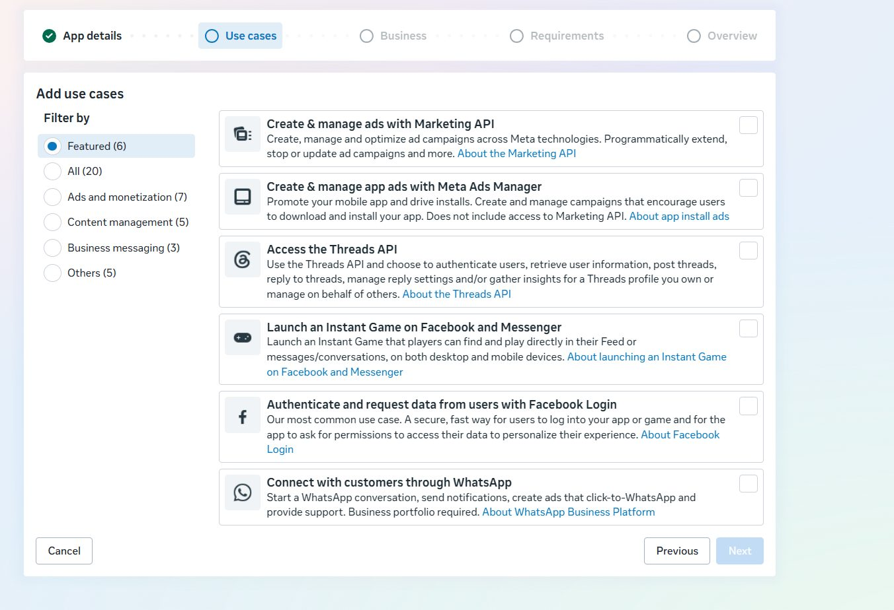
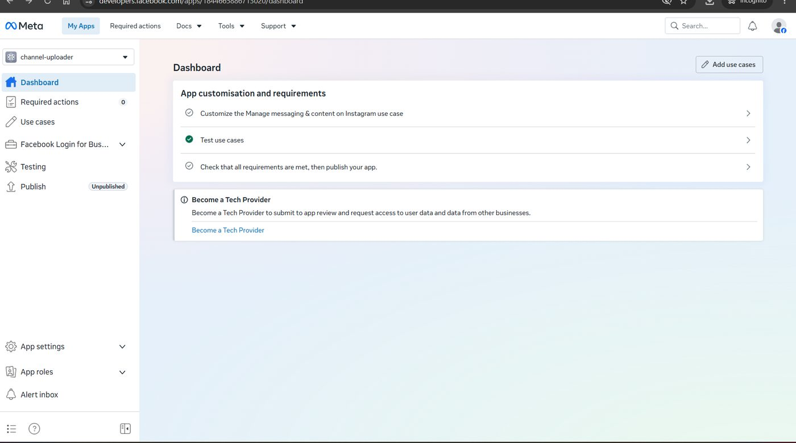
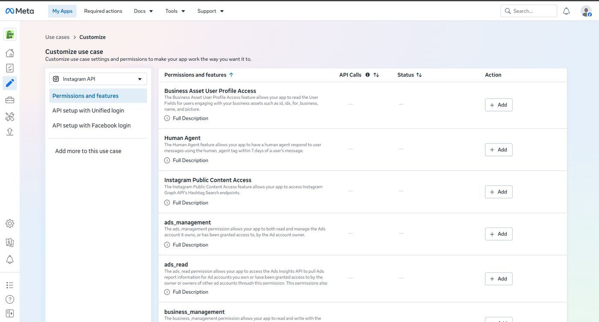
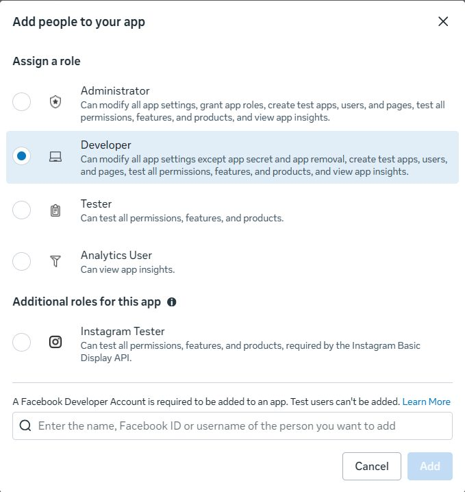
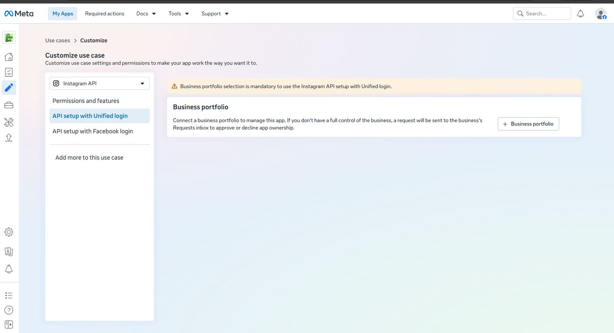
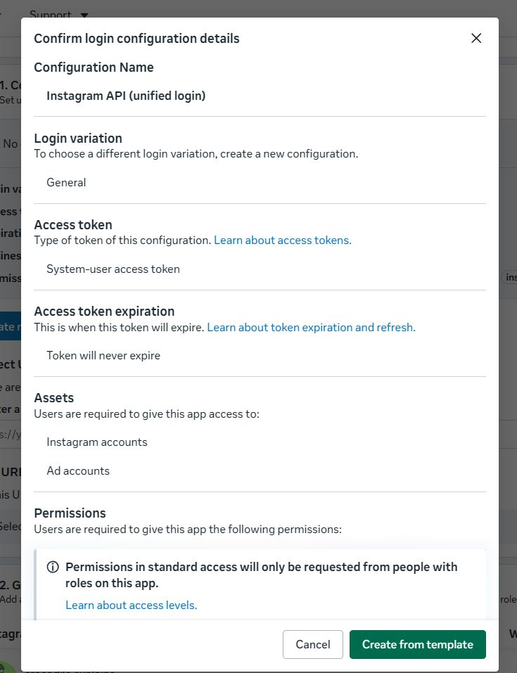
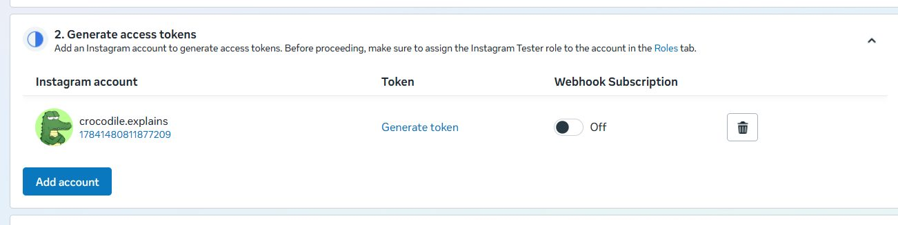

# NotebookLM short

Every day at 09:00 IST (or by hand) this workflow:

- picks a random unused topic from `topics.json`
- lets NotebookLM research it on the web
- makes a 60 s vertical video: question hook, clear explanation, "subscribe and follow us" line
- cuts the NotebookLM end card
- writes a title, description and hashtags
- saves everything to the `videos` branch under `nlm/`
- uploads to every YouTube and Instagram account you configured (optional)

Where to add secrets: repo > Settings > Secrets and variables > Actions > New repository secret.

---

## 1. NotebookLM token (required)

Use a throwaway Google account, not your main one.

- On your PC run:

  ```bash
  pip install "notebooklm-py[headless,browser]"
  notebooklm login --master-token --account throwaway@gmail.com
  ```

- A browser opens, log in with the throwaway account
- Open the file `~/.notebooklm/profiles/default/master_token.json` (Windows: `C:\Users\YOU\.notebooklm\profiles\default\master_token.json`)
- Copy its whole content
- Add secret `NOTEBOOKLM_MASTER_TOKEN_JSON` and paste

Check it worked: Actions tab > NotebookLM short > Run workflow. The first job, Precheck, must be green.

---

## 2. Instagram upload (optional)

Free. Takes about 10 minutes. Everything below is on developers.facebook.com unless the step says phone.

### 2.1 Instagram account

- Phone: Instagram > Settings and activity > Account type and tools > Switch to professional account > Creator
- Personal accounts cannot use the API

### 2.2 Create the Meta app

- Go to developers.facebook.com > My Apps > Create App
- App details: any name, your email, Next
- Use cases: left filter **Content management** > tick **Manage messaging and content on Instagram** > Next

  

- Business: I don't want to connect a business portfolio yet > Next
- Requirements: Next > Create app

  

### 2.3 Permissions

- Dashboard > click **Customize the Manage messaging & content on Instagram use case**
- On **Permissions and features** click Add on these two only:
  - `instagram_business_basic`
  - `instagram_business_content_publish`

  

### 2.4 Add the Instagram account as tester

- Left sidebar > App roles > Roles > Add people
- Pick **Instagram Tester** (last option) > type the Instagram username > Add

  

- Phone: Instagram > Settings and activity > Apps and websites > Tester invites > Accept

### 2.5 Business portfolio and configuration

- Use cases > Customize > **API setup with Unified login**
- It says a business portfolio is mandatory: click **+ Business portfolio** > Create new > any name > Create (free, no company needed)

  

- Section **1. Configure your app** > Create configuration > **Create from template**. The template token never expires.

  

### 2.6 Get ID and token

- Section **2. Generate access tokens**: the account is listed with a number under it. That number is the user ID.
- Click **Generate token** > Continue with Instagram > log in as that account > pick the portfolio > tick the account > Allow > copy the token

  

### 2.7 Add secrets

| Secret | Value |
|---|---|
| IG_USER1_ID | the number under the account |
| IG_USER1_TOKEN | the token |
| IG_USER1_NAME | optional label, shown in the upload summary (job name stays `user1`) |

Skip sections 3 (webhooks) and 4 (App Review). Tester accounts can post without review.

Private repo note: Instagram must fetch the video from a public URL, so the file is parked 1 hour on tmpfiles.org. Public repo: the videos branch raw URL is used directly.

---

## 3. YouTube upload (optional)

- console.cloud.google.com > New project > APIs and services > Enable **YouTube Data API v3**
- OAuth consent screen > External > fill name and email > add the channel Google account as **Test user**
- Credentials > Create credentials > OAuth client ID > **Desktop app** > copy client ID and client secret
- On your PC:

  ```bash
  pip install google-auth-oauthlib
  python pipeline/notebooklm/yt_get_refresh_token.py --client-id ID --client-secret SECRET
  ```

- A browser opens, log in with the channel account, allow. The script prints the refresh token.

| Secret | Value |
|---|---|
| YT_USER1_CLIENT_ID | client ID |
| YT_USER1_CLIENT_SECRET | client secret |
| YT_USER1_REFRESH_TOKEN | printed by the script |
| YT_USER1_PRIVACY | optional: public, unlisted, private |
| YT_USER1_NAME | optional label, shown in the upload summary |

Known limits:

- Unverified Google app: uploads are forced to private. Submit the app for verification to post public.
- Consent screen left in Testing: refresh token dies after 7 days. Set it to In production.
- Default quota is about 6 uploads per day.

---

## 4. More accounts

- Repeat the secrets with 2, 3, 4 ... (`IG_USER2_ID`, `IG_USER2_TOKEN`, `YT_USER2_CLIENT_ID` ...)
- Each account uploads in its own job. One bad token does not stop the others.
- Incomplete sets are skipped with a warning in the Precheck job.
- Old style single secrets `IG_USER_ID`, `IG_ACCESS_TOKEN`, `YT_CLIENT_ID`, `YT_CLIENT_SECRET`, `YT_REFRESH_TOKEN` still work as account "default".

---

## 5. Run options

Actions tab > NotebookLM short > Run workflow.

| Input | Default | Values |
|---|---|---|
| genre | auto | science, technology, ai, space, physics |
| topic | empty | exact topic instead of random |
| research_mode | fast | fast, deep |
| format | short | short (9:16), explainer, cinematic (16:9) |
| style | auto | explainer only |
| publish | true | false = artifact only |
| keep_notebook | false | true = keep notebook in NotebookLM |
| upload | auto | off = skip all uploads |
| yt_privacy | public | public, unlisted, private |
| trim_outro | true | false = keep the NotebookLM end card |

Change the wording:

- Closing line: `CTA_LINE` in `.github/workflows/notebooklm-short.yml`
- End card trim fallback seconds: `OUTRO_TRIM` in the same file
- Topics: `topics.json`

---

## 6. Jobs

| Job | What it checks or does |
|---|---|
| Precheck | token present and valid, NotebookLM quota, deletes leftover notebooks, lists upload accounts |
| Make | topic, research, video, trim, thumbnail, captions |
| Publish | copies to `videos` branch, updates `nlm.json` |
| Upload platform / name | one job per account |

---

## 7. Errors

| Log says | Do |
|---|---|
| secret NOTEBOOKLM_MASTER_TOKEN_JSON is not set | Section 1 |
| NotebookLM auth failed | Section 1 again, token expired |
| quota exhausted | wait for the reset time printed in the log |
| research imported no sources | re-run, or pick another topic |
| no public URL for the video | tmpfiles.org down, re-run |
| YouTube video is private | Google app not verified |
| account incomplete - skipped | one of the numbered secrets is missing |
